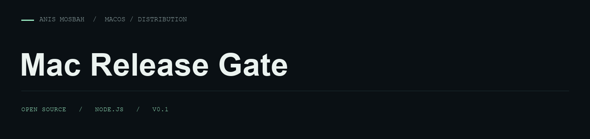
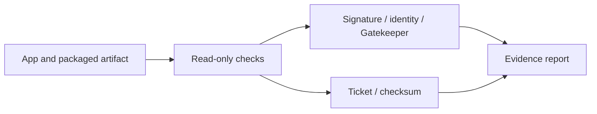

# Mac Release Gate

### Inspect the release before your users install it.

**Node.js 22+** · **MIT** · **v0.1.0** · [API](index.mjs) · [Tests](project.test.mjs)

Read-only release verification for teams distributing macOS applications directly. Combine **code-signature checks, Gatekeeper assessment, signing-identity inspection, stapled-ticket validation and streaming SHA-256** in one report.

## Release evidence in one place

| Check | Evidence |
| :--- | :--- |
| Bundle signature | `codesign --verify --deep --strict` result. |
| Distribution identity | Developer ID Application authority; ad-hoc signatures fail. |
| Gatekeeper | Execution assessment under the current machine policy. |
| Notarization ticket | `stapler validate` for the supplied app, DMG or PKG. |
| Artifact integrity | SHA-256 and optional comparison to an expected digest. |
| Portable reports | Terminal, JSON, Markdown and standalone HTML. |

## Run

```sh
git clone https://github.com/anistack72/mac-release-gate.git
cd mac-release-gate
node cli.mjs --app /path/Example.app --artifact /path/Example.dmg --require-staple
node cli.mjs --app /path/Example.app --format json > release-report.json
node cli.mjs --artifact /path/Example.zip --expect-sha256 YOUR_64_CHARACTER_SHA256
```

Replace the example paths and checksum with your actual values. Requires **Node.js 22+**. Native checks require macOS system tools; hashing works on other supported Node platforms. No runtime dependencies. Source distribution only; not published to npm.



## Make release policy explicit

- `--require-staple` makes ticket-validation failures block the gate. Otherwise they are warnings.
- `--strict` makes all warnings fail the gate.
- `--expect-sha256` compares the supplied file to a digest you obtained from a trusted source.
- Supplying only a DMG or checksum does not verify the app inside it; the report says so.

Exit codes: **0** no failed checks, **1** failed checks, **2** invalid input or tool error. Native checks requested on another OS produce an explicit failed check. System commands use argument arrays, have timeouts and do not run through a shell.

## Scope and limits

This tool does not sign, notarize, upload, install or modify artifacts. It does not request signing credentials. Reports use artifact basenames; review diagnostic output before sharing it externally. Gatekeeper assessment depends on the current machine policy, and a successful signature check is not a malware audit.

Permissions, clean-machine installation, application behavior, update signatures and data migrations still need their own release checks. ZIP files themselves are not stapled. Native verification tests use synthetic runner responses; a successful fixture is not evidence of a signed product.

## References

The verification flow is informed by Apple’s [notarization documentation](https://developer.apple.com/documentation/security/notarizing-macos-software-before-distribution/) and [custom notarization workflow](https://developer.apple.com/documentation/security/customizing-the-notarization-workflow). For Tauri, updater signatures remain a [separate mechanism](https://v2.tauri.app/plugin/updater/).

## Reproducible demonstration

```sh
node demo.mjs
node demo.mjs html > demo-report.html
```

The demo is explicitly labeled **synthetic**. It uses temporary local data or controlled fixture responses, never a third-party target. The generated HTML is standalone, with no remote scripts, fonts or analytics.

## Development

```sh
npm run check
npm test
```

Tests use local fixtures and local HTTP servers. The included CI matrix targets Node.js 22 and 24 on Linux, macOS and Windows. A local test pass does not mean that every CI platform has already run.

See [CONTRIBUTING.md](CONTRIBUTING.md) for changes and [SECURITY.md](SECURITY.md) for private security reports.

---

Built by **Anis Mosbah** · [Professional enquiries](mailto:contact@anis-mosbah.dev) · [MIT license](LICENSE)
